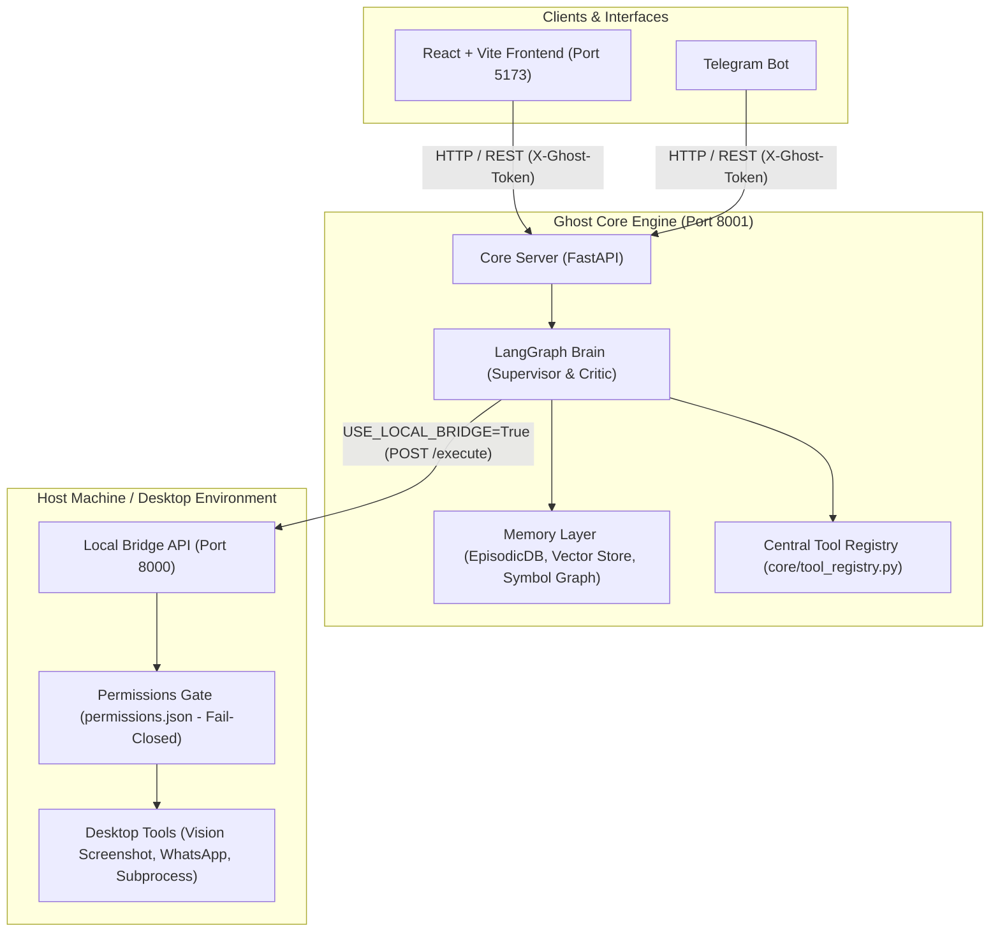

# Ghost Operator (v2)

**Ghost Operator** is an autonomous, local-first AI assistant built on LangGraph, engineered to manage workflows, write and run code, interact with operating system environments, and automate desktop actions through a decoupled architecture consisting of a persistent Core brain, an opt-in Host Bridge, and modern user clients.

---

## Architecture Overview

Ghost decouples heavy cognitive graph loops and state management from desktop-bound OS operations.



### Component Roles

1. **Ghost Core Server (`core_server.py` — Port 8001):**
   - Hosts the LangGraph supervisor/critic execution graph.
   - Manages episodic memory buffers, AST symbol dependency graphs, and durable knowledge.
   - Can run either locally or isolated inside a Docker container.
2. **Local Bridge (`local_bridge/main.py` — Port 8000):**
   - Runs directly on the host machine.
   - Exposes hardware- and desktop-bound tools (screen capture, local browser sessions, application launching) to the Core server over HTTP.
   - Enforces a fail-closed permission model.
3. **Frontend (`frontend/` — Port 5173):**
   - Modern React + Vite desktop workspace UI with real-time terminal output, chat interface, memory inspection, and settings panel.
4. **Telegram Adapter:**
   - Enables remote messaging and notifications, routing messages to the central Core server.

---

## Security Model

Ghost operates with defense-in-depth principles:

* **Token Authentication (`X-Ghost-Token`):**
  - All communication between clients, the Core server, and the Local Bridge requires a secret token.
  - Constant-time verification is enforced using `hmac.compare_digest` to prevent timing attacks.
* **Fail-Closed Permission Gate (`permissions.json`):**
  - The Local Bridge requires explicit user consent for each desktop tool (`ekran_goruntusu`, `whatsapp_mesaj_gonder`, `kodu_calistir`, etc.).
  - Default policy is **fail-closed**: if the configuration file is missing, corrupt, or an action is unspecified, access is denied (`False`).
* **Safe Subprocess Execution:**
  - Application launchers and command dispatchers use structured list arguments (`subprocess.Popen([arg1, ...])`) without shell interpolation (`shell=False`), preventing command injection.
  - `kodu_calistir` enforces directory restrictions, denying execution requests outside approved workspace/project boundaries.
* **Audit-Hook Execution Guard:**
  - Generated Python skills run with `sys.addaudithook` to constrain filesystem access via `Path.is_relative_to` checks against authorized directories.

> [!WARNING]
> **What This Is NOT:**  
> The Python audit-hook runner is a **risk-reduction constraint layer**, NOT a secure hypervisor or full operating-system sandbox. It reduces the surface of accidental or unauthorized path escapes, but does not provide complete kernel-level isolation. Untrusted code should always be treated with appropriate caution.

---

## Getting Started

### Prerequisites
* Python 3.11+
* Node.js 18+ (for frontend)
* Docker & Docker Compose (optional, for containerized Core)

### 1. Local Environment Setup

Clone the repository and install dependencies:
```bash
# Install Python dependencies
pip install -r requirements.txt

# Install frontend dependencies
cd frontend
npm install
cd ..
```

Configure your environment:
```bash
cp .env.example .env  # Or update your .env with your API keys
```

### 2. Running Locally

**Start the Local Bridge (Host Machine):**
```bash
python -m uvicorn local_bridge.main:app --host 0.0.0.0 --port 8000
```

**Start the Core Engine:**
```bash
python core_server.py
# Or: uvicorn core_server:app --host 0.0.0.0 --port 8001
```

**Start the Frontend:**
```bash
cd frontend
npm run dev
```

### 3. Running with Docker Compose

To run the Ghost Core brain inside a container while keeping the Local Bridge on the host:

```bash
# 1. Start Local Bridge on your host machine
python -m uvicorn local_bridge.main:app --host 0.0.0.0 --port 8000

# 2. Build and launch Ghost Core via Docker
docker-compose up --build
```

The container automatically maps `host.docker.internal` to connect back to the Local Bridge on port 8000.

---

## Testing & Quality

Run the test suite with `pytest`:
```bash
pytest tests
```

Tests cover:
* Bridge tool naming and canonical registry synchronization (`test_tool_naming.py`)
* Bridge permission enforcement and token authentication (`test_bridge.py`)
* Sandbox path containment and network constraints (`test_sandbox_runner.py`)
* Filesystem path resolvers and command restrictions (`test_fs.py`)
* AST symbol graph relationship extraction (`test_symbol_graph.py`)
* Core server endpoints and headless session handling (`test_core_server.py`)

---

## Known Limitations

* **Desktop Automation:** Vision capture and desktop GUI interactions require an active graphical desktop session and cannot operate in a headless cloud server without an attached X11/VNC display.
* **Platform Differences:** Tool execution commands vary between Windows and Linux/macOS environments (e.g., protocol handlers vs. direct process binaries).
* **Model Inference Latency:** Agentic graph loops depend on LLM response speeds; tool-calling iterations introduce network and processing delays.

---

## Roadmap (v2 Focus)

- [ ] **Native Container Sandbox for Code Execution:** Transition code execution tasks from audit-hook subprocesses to disposable Docker containers.
- [ ] **Full Multi-Session Concurrency:** Complete unified state synchronization across multiple simultaneous client adapters (Web UI, Telegram, Voice).
- [ ] **Working State Memory:** Expand episodic RAG memory with active project workspace context persistence across restarts.

---

## Türkçe Kısa Özet

**Ghost Operator (v2)**, LangGraph mimarisi üzerine kurulu, yerel öncelikli (local-first) bir otonom işletim sistemi ve görev asistanıdır.

* **Ayrık Mimari:** Ajanın karar alma ve hafıza motoru (Core Server) ile masaüstü/donanım etkileşimleri (Local Bridge) birbirinden ayrılmıştır. Core sunucu Docker konteyneri içinde izole çalışabilirken, Local Bridge ana makinede ekran görüntüsü, WhatsApp ve dosya işlemlerini yönetir.
* **Güvenlik:** API çağrıları zamanlama saldırılarına karşı `hmac.compare_digest` ile korunan `X-Ghost-Token` doğrulamasına tabidir. Masaüstü araçları `permissions.json` üzerinden fail-closed (varsayılan olarak kapalı) izin denetiminden geçer; kod çalıştırma işlemleri çalışma alanı köküyle kısıtlıdır.
* **Kullanım:** `pytest tests` komutu ile tüm güvenlik ve işlev testleri çalıştırılabilir; Core ve Local Bridge servisleri bağımsız veya Docker Compose ile birlikte koşturulabilir.
